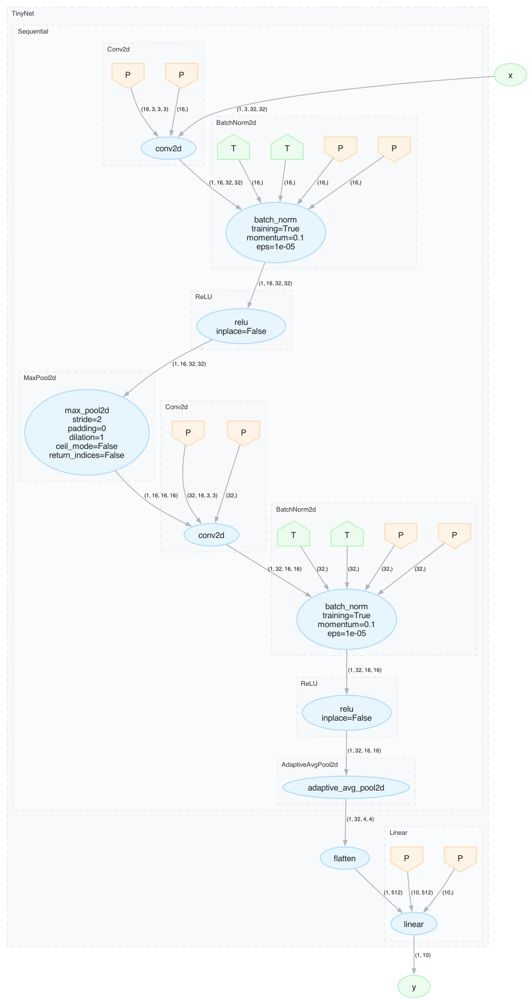
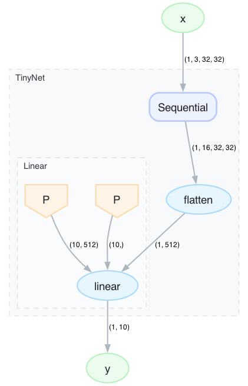
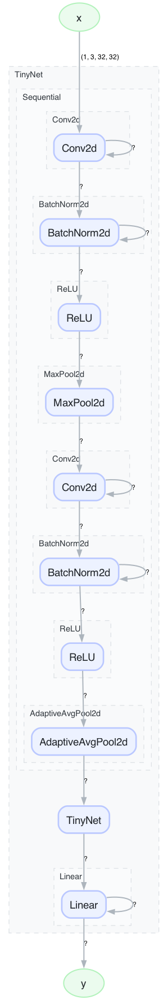
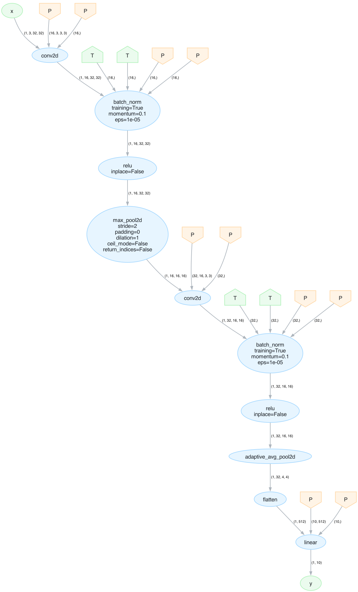

<!--
SPDX-FileCopyrightText: 2026 European Centre for Medium-Range Weather Forecasts (ECMWF)
SPDX-License-Identifier: Apache-2.0
-->

# torch-flowgraph

PyTorch computation graph tracing and visualisation.

[](https://github.com/ecmwf/codex/raw/refs/heads/main/Project%20Maturity#emerging)
[](https://opensource.org/licenses/apache-2-0)

> [!IMPORTANT]
> This software is **Emerging** and subject to ECMWF's guidelines on [Software Maturity](https://github.com/ecmwf/codex/raw/refs/heads/main/Project%20Maturity).

## What is it?

Deep learning models built with PyTorch are defined as imperative Python code,
which makes them flexible but hard to inspect structurally. **torch-flowgraph**
bridges that gap: it traces a `torch.nn.Module`'s forward pass and produces an
explicit graph of every operation, together with a hierarchical cluster tree
that mirrors the module nesting. You can then serialise, transform, and
visualise that graph — for example to generate publication-quality architecture
diagrams, to compare two model topologies, or to feed the structure into
downstream analysis tools.

In short, torch-flowgraph answers the question *"what does my model actually
compute, and how are the pieces connected?"* — and gives you a concrete,
manipulable data structure to work with.

### Key capabilities

* **Trace** any `nn.Module` into a node-and-edge directed graph with full
  tensor-shape annotations.
* **Cluster** nodes by `nn.Module` hierarchy, or **recluster** by depth, by
  name, or by dataflow decomposition (McCreary clan parsing).
* **Collapse** clusters to any depth for adjustable levels of detail.
* **Render** to Graphviz DOT / PNG / SVG / PDF with sensible defaults.
* **Serialise** to JSON for persistence, diffing, or consumption by other
  tools.
* **Convert** to NetworkX `DiGraph` for programmatic graph analysis.
* **Validate** a graph's structural consistency from the CLI or in code.

## Installation

```bash
pip install torch-flowgraph
```

**Requirements:** Python ≥ 3.9, `networkx`, `tqdm`. PyTorch must be installed
separately (it is not listed as a hard dependency so that the serialization
and graph-transformation API can be used without a GPU environment).

Rendering (`plot_graph`, and `dot -T…` on saved DOT files) additionally
requires the Graphviz `dot` executable on your `PATH`
(`brew install graphviz` / `apt install graphviz`).

## Gallery

Run `python demo.py` to regenerate all images in `images/`: module-cluster and
flat PNGs of the model below, plus `links_*.svg` where every operation links to
its PyTorch documentation page.

**Op-level graph with `nn.Module` cluster boxes** — every PyTorch operation is
one node; subgraph boxes reflect the `nn.Module` hierarchy:



**Collapsed to depth 1** — clusters deeper than 1 are replaced by a single
representative node:



**Module-only view** — each `nn.Module` becomes a single node:



**Without cluster boxes** — the same op-level graph rendered with
`clusters=[]`:



## Quick start

### Trace a model

```python
import torch
import torch.nn as nn
from torch_flowgraph.model import ModelGraph

class TinyNet(nn.Module):
    def __init__(self):
        super().__init__()
        self.features = nn.Sequential(
            nn.Conv2d(3, 16, 3, padding=1), nn.BatchNorm2d(16), nn.ReLU(),
            nn.MaxPool2d(2),
            nn.Conv2d(16, 32, 3, padding=1), nn.BatchNorm2d(32), nn.ReLU(),
            nn.AdaptiveAvgPool2d(4),
        )
        self.classifier = nn.Linear(32 * 16, 10)

    def forward(self, x):
        x = self.features(x)
        return self.classifier(x.flatten(1))

graph = ModelGraph.from_model(TinyNet(), shape=(1, 3, 32, 32), add_extra_nodes=True)

print(graph)        # Model(26 nodes)
print(graph.depth)  # 2 — cluster hierarchy depth
```

### Save and reload

```python
# Persist to JSON
graph.save_json("tinynet.json")

# Reload (returns a GraphBase, not a ModelGraph)
from torch_flowgraph import GraphBase
graph2 = GraphBase.from_json_file("tinynet.json")
```

### Render to PNG

```python
graph.plot_graph("tinynet.png")                      # op-level, module cluster boxes
graph.plot_graph("tinynet_flat.png", clusters=[])    # op-level, no cluster boxes
graph.collapsed(max_depth=1).plot_graph("tinynet_shallow.png")
```

Function nodes can optionally include hyperlinks to the PyTorch
documentation (off by default):

```python
graph.plot_graph("tinynet_links.svg", links=True)    # clickable URLs in SVG output
```

### Export to Graphviz DOT

```python
graph.save_dot("tinynet.dot")
graph.save_dot("tinynet_links.dot", links=True)     # with PyTorch doc URLs
# render with: dot -Tsvg tinynet.dot -o tinynet.svg
```

Pass `show_clusters=False` to keep subgraph blocks in the DOT output (so the
layout engine still groups related nodes) while making the visual boxes
invisible.  This is useful when you want clean layout without cluster outlines:

```python
graph.save_dot("tinynet_layout.dot", show_clusters=False)
graph.plot_graph("tinynet_layout.svg", show_clusters=False)
```

### Convert to NetworkX

```python
G_ops     = graph.to_op_networkx()      # op-level DiGraph (one node per PyTorch op)
G_modules = graph.to_module_networkx()  # module-level DiGraph (one node per nn.Module)
```

## Graph transformations

### Collapse clusters

Reduce visual complexity by collapsing all clusters deeper than a given
level into single `CollapsedNode` representatives:

```python
shallow = graph.collapsed(max_depth=1)
shallow.plot_graph("tinynet_depth1.png")
```


`graph.depth` is the maximum cluster depth, so any `max_depth >= graph.depth`
leaves the graph unchanged.

### Module-only view

Produce a coarse graph where every cluster becomes a single node:

```python
modules = graph.only_modules()
modules.plot_graph("tinynet_modules.png")
```


### Reclustering

`graph.recluster(strategy)` returns a new graph with the same nodes and edges
but a different cluster tree. Four strategies ship with the package:

```python
from torch_flowgraph import (
    ClanClustering, LevelClustering, NameClustering, NoClustering,
)

# Dataflow decomposition (McCreary clan parsing) instead of the code hierarchy.
graph.recluster(ClanClustering())

# Keep only the boxes at level 1 (0 = outermost modules); all nodes stay visible.
graph.recluster(LevelClustering(1))
graph.recluster(LevelClustering([0, 2]))        # several levels at once

# Keep only boxes with the given module names.
graph.recluster(NameClustering(["Conv2d", "Linear"]))

# Drop every box, keeping all nodes at the top level.
graph.recluster(NoClustering())
```

`graph.cluster_levels` and `graph.cluster_names` list the levels and names
available for the two selective strategies. `apply_clan_clustering(graph)` is
a convenience wrapper for `graph.recluster(ClanClustering())`.

## Interactive viewer

`viewer.py` is a [Streamlit](https://streamlit.io) app for exploring a graph
interactively in the browser — load a JSON graph and adjust the level of
detail without writing any code.

```bash
pip install streamlit          # not a hard dependency of torch-flowgraph

streamlit run viewer.py                    # start empty, pick a file in the sidebar
streamlit run viewer.py -- tinynet.json    # pre-load a graph
```

This opens the app in your browser. From the sidebar you can:

* **Load a graph** from a file path or by uploading a JSON file.
* **See graph info** — node count, edge count, and cluster depth.
* **Set the detail level** with a slider (backed by
  `GraphBase.collapse_to_level`). Level 0 collapses each top-level module to a
  single node (e.g. `x → TinyNet → y`); each higher level opens one more layer
  of cluster boxes and collapses the level below it, up to `graph.depth` which
  shows every operation.

The graph is rendered as SVG, which needs the Graphviz `dot` executable on your
`PATH`.

## Validation

Graphs can be checked for structural inconsistencies — dangling edge
endpoints, self-loops, nodes claimed by more than one cluster (or none), and
directed cycles. Use the CLI:

```bash
torch-flowgraph validate tinynet.json
python -m torch_flowgraph validate tinynet.json    # equivalent
```

It prints a report and exits non-zero when the graph is inconsistent. The same
check is available programmatically and returns a boolean:

```python
from torch_flowgraph import GraphBase, validate_graph

graph = GraphBase.from_json_file("tinynet.json")
if not validate_graph(graph):
    raise SystemExit("graph is inconsistent")
```

## API reference

| Symbol | Description |
|---|---|
| `GraphBase` | Base class for all graph representations. Returned by JSON deserialization. |
| `GraphBase.from_json_file(path)` | Load a graph from a JSON file. |
| `GraphBase.from_dict(data)` | Load a graph from a dictionary. |
| `GraphBase.as_dict()` | Serialize to a JSON-compatible dictionary. |
| `GraphBase.save_json(path)` | Serialize to JSON. |
| `GraphBase.save_dot(path, ..., show_clusters=True)` | Write a Graphviz DOT file; pass `show_clusters=False` for invisible layout-hint boxes. |
| `GraphBase.plot_graph(path, fmt=None, ...)` | Render to PNG/SVG/PDF via Graphviz; format inferred from the extension. Extra kwargs go to `save_dot`. |
| `GraphBase.collapsed(max_depth)` | Return a new graph with clusters deeper than `max_depth` collapsed. |
| `GraphBase.collapse_to_level(level)` | Return a new graph with clusters at `level + 1` collapsed to single nodes (boxes kept above). |
| `GraphBase.only_modules()` | Return a one-node-per-cluster graph. |
| `GraphBase.merge_repeated()` | Merge runs of identical sibling clusters into one labelled `"name x N"`. |
| `GraphBase.explore(expanded_paths, auto_expanded_paths)` | Collapsed view with selective per-cluster expansion and click-to-expand URLs. |
| `GraphBase.recluster(clustering)` | Return a new graph reclustered by a `Clustering` strategy. |
| `GraphBase.use_clusters(clusters)` | Return a new graph with a different cluster hierarchy. |
| `GraphBase.cluster_levels` | Selectable cluster levels that contain nodes. |
| `GraphBase.cluster_names` | Distinct cluster names that contain nodes. |
| `GraphBase.depth` | Maximum cluster depth. |
| `GraphBase.sources_and_sinks()` | `(sources, sinks)` — nodes with no incoming / no outgoing edges. |
| `GraphBase.node_depths()` | Cluster depth of each node. |
| `GraphBase.shortcut_weights()` | Per-edge count of nodes bypassed by the edge. |
| `GraphBase.to_op_networkx(links=False)` | Convert to an op-level NetworkX `DiGraph`. |
| `GraphBase.to_module_networkx()` | Convert to a module-level NetworkX `DiGraph`. |
| `ModelGraph` | Subclass of `GraphBase` built by tracing a live PyTorch model. |
| `ModelGraph.from_model(model, shape, add_extra_nodes=False)` | Trace a `torch.nn.Module`. |
| `Clustering` | Abstract base class for reclustering strategies. |
| `ClanClustering()` | Recluster by dataflow decomposition (McCreary clan parsing). |
| `LevelClustering(level)` | Keep only cluster boxes at the given level(s). |
| `NameClustering(names)` | Keep only cluster boxes with the given names. |
| `NoClustering()` | Drop all cluster boxes. |
| `apply_clan_clustering(graph)` | Shorthand for `graph.recluster(ClanClustering())`. |
| `validate_graph(graph, verbose=True)` | Structural consistency check; returns a boolean. |

## Node types

Node classes live in `torch_flowgraph.nodes`; they are constructed by the
tracer and by JSON deserialization rather than directly by users.

| Type | Description |
|---|---|
| `FunctionNode` | A PyTorch autograd function (e.g. `aten::conv2d`). |
| `ModuleNode` | An `nn.Module` boundary node. |
| `TensorNode` | An intermediate tensor. |
| `ParameterNode` | A model parameter (weight / bias). |
| `ShapeNode` | A shape or size value. |
| `LabelNode` | A plain labelled node, used for the `"x"` / `"y"` graph entry and exit markers. |
| `CollapsedNode` | A placeholder representing a collapsed cluster. |

## License

[Apache License 2.0](LICENSE) In applying this licence, ECMWF does not
waive the privileges and immunities granted to it by virtue of its
status as an intergovernmental organisation nor does it submit to any
jurisdiction.
